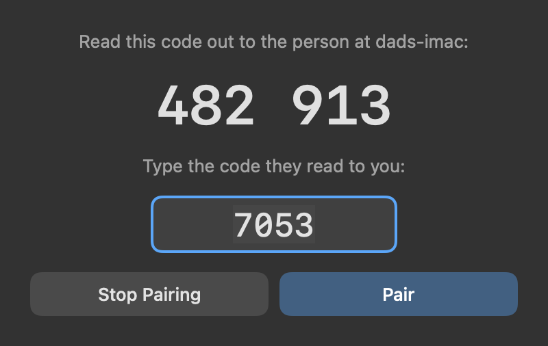

<p align="center">
  
</p>

<h1 align="center">Nimbus Drop</h1>

<p align="center">
  Send large files and whole folders to another Mac on your local network, as fast as the
  network allows. Like AirDrop, but for 30 GB of photos over the LAN: you drag a folder onto
  the other Mac, the person there chooses where to save it, and it arrives checked and
  complete. Every drop is encrypted, and goes only to a Mac the two of you have paired.
  No internet is needed.<br>
  <b>Fast:</b> it fills a gigabit wire, and over a Thunderbolt cable its encrypted stream
  measures 36 to 38 Gbit/s.
  <b>Formally verified where it counts:</b> from 0.4 the protocol is proved in a formal
  model, and the code that makes each security decision is held equal to a model-checked
  specification.<br>
  A menu bar icon that opens a small window. Swift, SwiftPM, AppKit and SwiftUI. One dependency: our own
  <a href="https://github.com/njoubert/nimbus-updater">nimbus-updater</a>, which keeps it up to date.
</p>

<p align="center">
  <br>
  <sub>Rendered by <code>--dump-window</code> with made-up Macs and drops.</sub>
</p>

```
./build.sh run            # debug build → dist/debug/Nimbus Drop Dev.app, launch it (add --fg for logs here)
./build.sh stop           # quit it
./build.sh test           # whole drops over loopback (swift test)
./build.sh install        # release build → /Applications/Nimbus Drop.app, register the Login Item, launch
./build.sh uninstall      # remove the app and everything it has kept (see Uninstalling)
./build.sh status         # running? installed? Login Item registered?
./build.sh app            # release build → dist/Nimbus Drop.app only
./build.sh dmg            # release build → dist/NimbusDrop-<version>.dmg, drag-to-Applications disk image
./build.sh icon           # re-render docs/icon.png
```

## Formal verification, from 0.4

0.4 is the first release whose security rests on proofs and model checking as well as on
tests:

- **The protocol is proved.** The handshake, the keys derived from it and everything they
  are used for, and the pairing with its two spoken codes: 43 lemmas proved in
  [Tamarin](https://tamarin-prover.com), against an attacker who owns the network and, for
  the pairing, hears the codes.
- **The decisions in the code are the ones in the models.** Pairing, trust, the rounds of a
  drop and who gets a place at the listener are each a pure state machine in Swift. On every
  push each is held equal, transition for transition, to its TLA+ specification, and TLC
  model-checks those specifications and the systems around them: a clock that lies, a
  network that fails, two Macs asking at once.
- **The checks are checked.** Every model has mutants that must fail (146 in TLA+, 15 in
  Tamarin), every guard in the code has a mutation that a named test must notice (267), and
  the runner refuses any run it cannot read in full.
- **The keys stay in.** The code that holds keys cannot write to anything, and the code that
  writes cannot read a key: the compiler holds that.

`./build.sh verify` runs all of it. This is formal verification of the protocol and of the
decision logic, not a proof of the whole app: the classes around the machines, the file
handling and the window are tested, not proved, and it has not been audited.
[What each claim rests on](docs/security/claims.md) ·
[every way it is checked, and the gaps](formal/README.md) · [Security](#security)

## What it does

**The menu bar icon opens the window**, and the window is the app. A right-click on the icon
gives the app's menu, the same one that sits under its name while the window is open: Receive
Drops, Open at Login, History, Internals, Settings, updates, Quit. A cloud
with an arrow while receiving is on, a hollow cloud while it is off, a percentage beside it
while a drop moves. The app has a Dock icon and its own menu only while the window is open.

**Pairing, once per pair of Macs.** A Mac you have not paired with shows as *New*. Drop a file
on it and the person there is asked whether to pair. Then, one code at a time: you read out the 6-digit code on your
Mac and they type it; then they read out theirs and you type it. That is all. The codes are safe to
say aloud; they are not passwords. After that the two Macs know each other by their keys,
whatever they are called and wherever they are, and nothing another Mac announces can take
either one's place. (No voice to hand? Right-click the tile, *Pair by Identity Number…*: each
of you enters the other's 30-digit number, sent by any means you trust.)

<p align="center">
  
</p>

**Keys do not last for ever.** Each Mac's key is replaced after 90 days (Settings: down to an
hour), and a pairing lasts until either key is. Nobody is asked to do anything then: the next
time you send to that Mac, the two of you exchange codes again. *Reset Identity* in Settings is
for when you think a key was copied: it tells every paired Mac it can reach to stop trusting
the old one at once, and lists any it could not reach.

**Receiving.** While *Receive drops* is on, this Mac announces itself on the local network and
Macs it is paired with can offer it files. Nothing is written until you say so. An offer raises a small
panel that says who is sending (the name you know that Mac by, and its IP address), what, how many files and how big,
with three answers: *Save to Downloads* (one click), *Save to…* (choose a folder
first; cancelling that declines) and *Decline*. Several drops arriving at once each get their
own panel and can be answered in any order. Turn
receiving off and this Mac disappears from everyone's list.

**Sending.** Under *Destinations* every Mac found is a tile showing its name, its IP address
and what it is to this Mac: *Paired*, *New*, *Renew pairing*, or *New · name in use* for an
unknown Mac using the name of one you know (it stands beside the real one, which keeps working). Drag a file, a folder, or a whole selection onto a tile, or click it and choose
from a panel. Files dropped beside the tiles go to the destination if there is only one, and
otherwise wait for you to click one. The other person accepts, and it goes.

**From Finder:** select files or folders, right-click, *Services › Nimbus Drop To…*. The window
opens holding them; click the destination.

**Only some kinds of file.** If what you send holds more than one kind of file, you are asked
which: each kind is listed with how many files and how big (`.jpg` and `.jpeg` count as one),
all ticked. Press Return to send everything, or untick what should stay behind, to send just
the JPEGs of a shoot, say. Folders keep their shape; folders left empty are not sent.

**Add by Address…** is for when a Mac is not found on its own (Bonjour blocked, a different
subnet, a VPN): type its IP address or host name, with `:port` if it is not 47823. (A Mac on
another subnet must have *Only from the local network* turned off in its Settings to take it.) It is asked
to prove who it is, shows up as a tile with its host name, and is remembered.

**The drops list** shows each one's progress, its rate in Mbps, how many connections it is
using and the time left, and lets you stop it. If connections were lost or damaged chunks were
caught along the way, it says how many. A received drop has a *Show in Finder* button. Both Macs
get a notification when a drop finishes or stops, and neither sleeps while one is under way.

**Finished drops clear themselves** from the window a minute after they end, failures too.
*History* (right-click the menu bar icon, the Window menu, or Settings) keeps the record: what,
to or from whom, when, how big, how it ended, with *Show in Finder* for what was received. It is
a file on this Mac (`~/Library/Application Support/com.njoubert.nimbusdrop/history.json`, the
last 500 drops), goes nowhere, and *Clear History* empties it.

**Internals** (in the menu, ⌘I) shows what the app is doing, live: this Mac's place on the
network, the Macs it can see with their versions, and every drop with each of its connections
(how many chunks each has carried, and whether it is moving). Under that runs the debug log as
it is written: every step of every drop with its time, each connection lost, each attempt to
reconnect, how many chunks were sent and how many had to go twice. Every line has a level
(debug, info, warning, error) and is coloured by it: amber for trouble a drop is getting past,
red for trouble that ended something. Filter by level, kind or text, pause it, copy it into a
bug report. The same lines are kept in `~/Library/Logs/Nimbus Drop/nimbus-drop.log` (two
files of 4 MB at most, on this Mac only), which is what to look at, or send, when a drop fails.

**Nothing is overwritten.** If `~/Downloads/Christmas 2026` already exists, the new one lands as
`Christmas 2026 2`, the way Finder keeps both.

**A bad network is ridden out.** A connection that drops, stalls or delivers a damaged chunk is
replaced and what it did not deliver is sent again. If the whole link goes (the other Mac walks
out of Wi-Fi range, changes networks, closes its lid for a moment), both sides hold the drop
open for a minute: the sender keeps looking for the other Mac, at a new address if it has one,
and carries on when it finds it. Nobody is asked twice.

**Retry.** A send that did not arrive has a *Retry* button. It carries on from what the first
attempt delivered; the other person is asked to accept again.

**An interrupted drop continues.** If the link stays down longer than that, or someone quits,
what arrived stays in a `….nimbusdrop-partial` folder in the destination. Send the same items
again, save to the same folder, and only what is missing is sent.

**What becomes of a partial folder:**

- It is removed when its drop completes: the finished items move out and the folder goes.
- It is kept when a drop stops for any reason (failed, cancelled, the app quit), for as long as
  you leave it there. Nothing deletes it for you and it never expires.
- It is reused, not overwritten, when the same sender sends the same files (same names, sizes
  and modification times) into the same folder again.
- If the files changed in between, or a different selection or set of file kinds is sent, that
  is a different drop: it gets a partial folder of its own and the old one stays.
- A partial folder you no longer want can simply be deleted.

**Versions.** Every copy announces its protocol version, and every connection begins with the
versions each side speaks, bound into the handshake so they cannot be altered on the way. This
version (protocol 3) does not talk to 0.2 or earlier at all: such a Mac shows as *Needs an
update*. Update every Mac together.

**Settings** (⌘, or right-click the menu bar icon): how many parallel connections a send uses,
this Mac's identity (its key, when it ends, how long keys last, its identity number, *Reset
Identity*), the Known Macs with *Rename* and *Forget*, *Open at login*, the history, updates,
and which version and protocol this copy is.

## How fast

As fast as the link, until the link outruns the disks. Between a MacBook Pro and a MacBook
Air (both Apple silicon, internal SSDs), encrypted as every drop is:

| Link | What was sent | Rate |
|---|---|---|
| **Thunderbolt 4 cable** (`iperf3` says it carries 37.6 Gbit/s) | the speed test: what a drop sends, encrypted, with no disk at either end | **36 to 38 Gbit/s** each way on 2 to 32 connections, 31 on one |
| Thunderbolt 4 cable | one 10.5 GB file, to a RAM disk | 20 to 23 Gbit/s |
| Thunderbolt 4 cable | one 10.5 GB file, to the MacBook Pro's SSD | 17 Gbit/s (24 while moving) |
| Thunderbolt 4 cable | one 10.5 GB file, to the MacBook Air's SSD, 86% full | 7.4 to 8.5 Gbit/s |
| Gigabit Ethernet | 1.58 GB in 5,102 files | 928 Mbps (116 MB/s), the wire's ceiling |
| Gigabit Ethernet | one 6.29 GB file | 905 Mbps |
| Gigabit Ethernet, through a proxy that damaged 19 chunks, cut 36 connections and took the link away for 30 s | one 6.29 GB file | arrived identical, 568 Mbps overall |

The engine and its encryption fill a Thunderbolt cable. A real drop over one reaches 20 to
23 Gbit/s before a disk is involved, and from there goes as fast as the disks do. On gigabit
the wire is the limit. (Thunderbolt measured 2026-11-23, gigabit 2026-11-24. Not measured:
10 GbE and Wi-Fi.)

**The same Mac to itself** (no network, so one machine does the sealing and the opening):

| | |
|---|---|
| One 6 GB file | 3.2 GB/s (25 Gbit/s) with 8 connections, 2.6 GB/s with 1 |
| 200 × 8 MB files | 4.7 GB/s |
| 10,000 files of 4 to 13 KB | 1.1 s |

Before encryption (protocol 2, 2026-11-22), for comparison: 927 Mbps over gigabit Ethernet
with 9.29 GB in 10,401 files, and 3.2 GB/s from a Mac to itself on 8 connections. On gigabit,
encryption cost nothing that shows.

## How it works

- **Finding each other:** Bonjour, service type `_nimbusdrop._tcp`, says where a Mac is. Who it
  is, it has to prove: each address found is asked to show it holds a key (the first two
  messages of a handshake), and a tile's state comes from that and from nothing the Mac
  announces. The listener prefers port 47823 and takes any free one otherwise.
- **Identity:** each Mac has an X25519 key, kept in a file that only that Mac's Secure Enclave
  can open, so a backup or Migration Assistant does not carry it to another machine.
- **A drop:** one control connection, a Noise XX handshake between the two Macs' keys
  (`Noise_XX_25519_AESGCM_SHA256`), carries the offer, the answer, the manifest (every file,
  folder and symlink with size, time and mode) and the receiver's note of what it already has.
  The sender checks the receiver's key before saying anything about itself or the drop. Then 8
  parallel TCP connections (*Parallel connections* in Settings: 1 to 16) carry the data in
  4 MiB chunks, each connection under a key of its own derived from that handshake. Every
  connection takes the next unsent chunk from one shared list, so a single huge file is spread
  across all of them and so is a folder of small ones.
- **Sealed end to end:** every chunk is sealed with AES-256-GCM, and so is the small header
  before it that says which file and chunk it is; each is opened whole before anything is
  written. A flipped bit, a replayed record or a record moved to another place does not open.
  Fresh keys for every drop, discarded afterwards.
- **Repaired in rounds:** when the sender has written everything it says so, the receiver
  answers with what is still missing, and the sender sends that. A lost connection or a damaged
  chunk therefore costs a re-send of a few megabytes, not the drop.
- **Not waited on for ever:** a connection that moves nothing for a minute is closed and
  replaced; a drop with no sign of life for three minutes is given up, and can be continued.
- **Written where it belongs:** each chunk is written straight to its offset in its file
  (`pwrite`), so nothing is reassembled afterwards. Modification times and permissions are set
  at the end and the finished items are moved into place in one rename each.
- **Works with no internet:** no server, no account, no time server. Key lifetimes are counted
  on the Mac's own clock that runs through sleep and cannot be set, so they hold on a network
  with no route out.
- **Versioned:** the protocol is 3.1 (3.1 added the speed test; drops between 3.0 and 3.1 work as before). The first number changes when two copies could no longer
  exchange a drop, the second when something is added that an older copy can ignore.

The design, the two independent reviews it went through and the answer to each finding are in
[docs/plans/secure-drops-plan.html](docs/plans/secure-drops-plan.html).

Not carried over: extended attributes (Finder tags), resource forks and ownership. Symlinks are
sent as symlinks, and recreated when they point within the drop. Sockets, devices and pipes are
skipped.

## Setting up

Download the disk image from the [latest release](https://github.com/njoubert/nimbus-drop/releases/latest),
open it, and drag Nimbus Drop onto Applications. It is signed with a Developer ID and notarized by
Apple, so it opens without a warning.

Both Macs need Nimbus Drop running, Apple silicon and macOS 15 or later, on the same network.
The first launch asks for **Local Network** access; allow it, or the Macs cannot see each other
(System Settings › Privacy & Security › Local Network to change it later). Launched from
`/Applications` it adds itself to Login Items once, so the Mac is ready to receive after a
restart; turn that off in Settings (*Open at login*) or in System Settings.

## From the command line

The same engine without the app, for scripts and for a Mac you reach over ssh:

```
NimbusDrop --pair macstudio               # pair with it: prints this side's code, asks for the other's
NimbusDrop --receive ~/Incoming          # take drops from paired Macs, asking on the terminal for each
NimbusDrop --send macstudio ~/Pictures/Christmas   # a Mac you have paired, by the name --known shows; or HOST, or HOST:PORT
NimbusDrop --speed macstudio              # how fast the two Macs can go, both ways, with no disk involved
NimbusDrop --peers                        # the Macs found in three seconds, and what each is to this one
NimbusDrop --identity                     # this identity's key tag, identity number and end date
NimbusDrop --known                        # who it is paired with (--forget TAG, --reset-identity)
```

The command line has an identity of its own, separate from the app's (and one per `--name`), so
a terminal and the app on one Mac are two Macs to each other. `--receive` asks before each drop
and answers requests to pair the same way. For a Mac nobody is sitting at there is one explicit
grant: `--unattended-from <key tag> --receive DIR` accepts without asking, but only from that
one paired key, into that folder, one drop at a time (`--max-bytes N` caps each).

## Security

**What it protects on the network.** Someone listening sees that two Macs are exchanging
something, roughly how much, and when; not the names, the folders or the contents. Someone in
the middle cannot read or alter a drop, and cannot get between two Macs at pairing either, even
if they hear the codes read out: the codes describe the connection, they are not a password,
and a Mac in the middle makes the two codes disagree. A Mac using the name of one you know is
shown as a new Mac with a warning, beside the real one. A key that was given up (*Reset
Identity*), replaced or has run out is refused from then on and reported. Recording traffic now
and stealing a key later does not open past drops.

**What it does not.** Nothing is padded, so volume and timing can be read (one file's drop
shows roughly that file's size). Software already running as you on your own Mac can read your
files, and this Mac's key while the app runs. Pairing means "this is that Mac", not "what it
sends is safe": every drop still has to be accepted by a person.

**What it defends on your Mac**, from a paired Mac that means harm as much as from anyone.
Accepting a drop means receiving the files you were shown into the folder you chose, and
nothing else:

- Nothing is written until you click (the accept button has no Return key, so typing in another
  app cannot accept one by accident), and what arrives must be exactly what was offered: the
  same names, file count and size.
- Everything a drop writes is confined to its own folder. Paths are checked as text and again
  against the disk, one folder at a time, without following symlinks; names that differ only in
  case are refused.
- Nothing existing is overwritten, nothing arrives set-uid, and the app runs as you, never as
  root.
- What is received is marked as a download (the quarantine flag AirDrop and browsers set), so
  macOS asks before an app or a script from a drop is run for the first time. Photos and
  documents open as usual.
- A symlink that points outside its drop is left out (the drop says how many were); links
  within the drop are kept.
- By default only Macs on the same subnet as this one can connect at all. *Settings › Receiving
  › Only from the local network* turns that off, for a VPN or another subnet.
- A stranger cannot make it use up memory, hold connections open or bury the screen in
  questions. Every connection is held to what it has proved: a kilobyte and ten seconds before
  a key, a few connections and no more for a key nobody paired, one request to pair on screen
  at a time with a growing pause after each refusal. Nothing is sent to, or shown from, a Mac
  that is not paired.

**History.** A review on 2026-11-22 found that versions before 0.2.2 could be made to write a
file outside the chosen folder by a sender whose drop was accepted, and 0.2.x was unencrypted
and unauthenticated throughout. **Use 0.3 or later.** The design of 0.3 was reviewed twice
before it was built, by two different models asked to break it; `Tests/NimbusDropCoreTests`
holds their attacks (`ProtocolTests`, `PairingTests`, `TrustTests`, `SecurityTests`), vectors
from a second implementation written in another language (`VectorTests`, `scripts/vectors.py`),
and `scripts/mutate.py` breaks each guard in turn to check that a test notices. It has not had
a review by a professional cryptographer.

**Checked by machine.** `formal/` holds models of the parts the security rests on, and
`./build.sh verify` runs them: the handshake, the keys derived from it and what they are used
for, and the pairing with its two spoken codes, proved in Tamarin against an attacker who owns
the network (and, for the pairing, hears the codes); the trust store and how trust is
withdrawn, a key's end against a clock that lies, a drop's rounds under a failing network,
who gets a place at the listener, and two Macs asking each other at once, model-checked in
TLA+. Four pieces of the code, the state machines that decide what a pairing message means,
what a key is to this Mac, what each message of a drop means and which connection gives way,
are each checked to be the same machine as its specification, transition for transition; the
classes around them are tied to the models by tests, not by proof. The code that holds keys
cannot write to anything, and the code that writes cannot read a key: the compiler holds
that. `docs/security/claims.md` lists every claim with the kind of evidence it has, and
`formal/README.md` lists every way the app is checked, the gaps that are left, and what none of it claims. It is not an audit, and the app has not had
one. The models, the tests written to hold them and an outside review between them found
about thirty things, a crash on one accepted drop among them; all are fixed in 0.4 or written
down.
`SECURITY.md` says how to report another.

## Testing it against a bad network

`swift test` sends whole drops through a proxy that misbehaves on cue: it caps and collapses
bandwidth, stalls, cuts one connection or all of them, refuses new ones, and flips bits, on a
script keyed to bytes carried so every run repeats. Each test ends one of two ways and checks
which: the drop arrived byte for byte, or it stopped cleanly with nothing half-made in the
destination and finished when sent again. The same proxy runs from the command line, to put
between two real Macs:

```
.build/release/nimbus-chaos --to macbookairm4.local --listen 47900 corrupt=400M --at 600MB rate=5M --at 680MB rate=off --at 3000MB kill=data
.build/release/NimbusDrop --send 127.0.0.1:47900 ~/Pictures/Christmas
```

It sits above TCP, so bandwidth, stalls, cut connections and corruption are real; packet loss is
imitated as the delay TCP would turn it into. Real per-packet loss needs the kernel's dummynet
and root, and is not part of the suite.

## What it talks to

Other copies of Nimbus Drop on your local network, and nothing else, with one exception that
it works perfectly well without (an air-gapped network is a supported place to use it):
unless *Check for Updates Automatically* is off, it asks `api.github.com` once a day for the
newest release and downloads it from `release-assets.githubusercontent.com`. Your files never
leave your network.

## How fast can two Macs go?

Right-click a paired Mac and choose **Request Speed Test…**. The person at that Mac is asked
whether to allow it, as they are for a drop. Then, for five seconds each way, the two Macs send
each other what a drop would send, encrypted as a drop is, with nothing read from a disk and
nothing written to one; the row then shows both rates. It answers "is it the network or the
disks?": a real drop can be no faster than this, and is slower when a disk is. Both Macs show
the result. Over
Thunderbolt 4 between two Apple silicon laptops it measures 36 to 38 Gbit/s, which is all the
cable carries.

## Uninstalling

**Settings › Uninstall Nimbus Drop…** removes the app and everything it has kept on the Mac:
its identity and pairings, the history, settings, logs, downloaded updates, Open at Login,
the Finder service, and any drops that never finished. The Macs it was paired with are told
to stop trusting it. Files you received stay where you saved them. macOS may go on listing
the app under Privacy & Security › Local Network; only macOS can remove that entry.

To keep the app but take "Nimbus Drop To…" out of Finder's Services menu, switch it off in
Settings › General (or in System Settings › Keyboard › Keyboard Shortcuts › Services).

## Licence

GPL-3.0-or-later. See [LICENSE](LICENSE).
