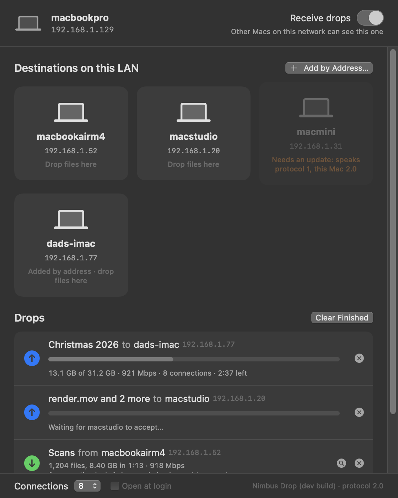

<p align="center">
  
</p>

<h1 align="center">Nimbus Drop</h1>

<p align="center">
  Send large files and whole folders to another Mac on your local network, as fast as the
  network allows. Like AirDrop, but for 30 GB of photos over the LAN: you drag a folder onto
  the other Mac, the person there chooses where to save it, and it arrives checked and
  complete.<br>
  A menu bar icon that opens a small window. Swift, SwiftPM, AppKit and SwiftUI. One dependency: our own
  <a href="https://github.com/njoubert/nimbus-updater">nimbus-updater</a>, which keeps it up to date.
</p>

<p align="center">
  <br>
  <sub>Rendered by <code>--dump-window</code> with made-up Macs and drops.</sub>
</p>

```
./build.sh run            # debug build → dist/debug/Nimbus Drop Dev.app, launch it (add --fg for logs here)
./build.sh stop           # quit it
./build.sh test           # whole drops over loopback (swift test)
./build.sh install        # release build → /Applications/Nimbus Drop.app, register the Login Item, launch
./build.sh uninstall      # unregister the Login Item, remove the app and its preferences
./build.sh status         # running? installed? Login Item registered?
./build.sh app            # release build → dist/Nimbus Drop.app only
./build.sh dmg            # release build → dist/NimbusDrop-<version>.dmg, drag-to-Applications disk image
./build.sh icon           # re-render docs/icon.png
```

## What it does

**The menu bar icon opens the window**, and the window is the app: there is no dropdown. A cloud
with an arrow while receiving is on, a hollow cloud while it is off, a percentage beside it
while a drop moves. The app has a Dock icon and its own menu only while the window is open.

**Receiving.** While *Receive drops* is on, this Mac announces itself on the local network and
other Macs running Nimbus Drop can offer it files. Nothing is written until you say so. An offer raises a small
panel that says who is sending (host name and IP address), what, how many files and how big,
with *Decline* and *Accept*. Accept, and a folder chooser asks where to save it, starting in
`~/Downloads`; cancelling that declines too. Turn
receiving off and this Mac disappears from everyone's list.

**Sending.** Under *Destinations on this LAN* every Mac found is a tile showing its host name
and IP address. Drag a file, a folder, or a whole selection onto a tile, or click it and choose
from a panel. Files dropped beside the tiles go to the destination if there is only one, and
otherwise wait for you to click one. The other person accepts, and it goes.

**Add by Address…** is for when a Mac is not found on its own (Bonjour blocked, a different
subnet, a VPN): type its IP address or host name, with `:port` if it is not 47823. It is asked
who it is, shows up as a tile with its host name, and is remembered.

**The drops list** shows each one's progress, its rate in Mbps, how many connections it is
using and the time left, and lets you stop it. If connections were lost or damaged chunks were
caught along the way, it says how many. A received drop has a *Show in Finder* button. Both Macs
get a notification when a drop finishes or stops, and neither sleeps while one is under way.

**Nothing is overwritten.** If `~/Downloads/Christmas 2026` already exists, the new one lands as
`Christmas 2026 2`, the way Finder keeps both.

**A bad network is ridden out.** A connection that drops, stalls or delivers a damaged chunk is
replaced and what it did not deliver is sent again, on the same accepted drop, without asking
anyone twice.

**An interrupted drop continues.** If the whole link goes, a lid closes, or someone quits, what
arrived stays in a `….nimbusdrop-partial` folder in the destination. Send the same items again,
save to the same folder, and only what is missing is sent. (If the files changed in between, it
is a new drop and starts over.) A partial folder you no longer want can simply be deleted.

**Versions.** Every copy announces its app version and its protocol version. A Mac that speaks a
different protocol major shows as *Needs an update* and cannot be sent to; an offer from one is
declined with both versions named. The bottom of the window shows this copy's.

At the bottom of the window: the number of parallel connections, *Open at login*, and the
version. The app menu has the same, plus updates.

## How fast

The network is the limit. Measured 2026-11-22 between a MacBook Pro and a MacBook Air (both
Apple silicon, internal SSDs):

| | |
|---|---|
| Gigabit Ethernet, 9.29 GB in 10,401 files (one 6 GB file, 400 × 8 MB, 10,000 small) | 927 Mbps (116 MB/s), the wire's ceiling |
| The same, through a proxy that flipped 25 bits, cut 32 connections and throttled twice | arrived identical, 430 Mbps overall |
| The same Mac to itself (no network), one 6 GB file | 3.2 GB/s with 8 connections, 3.9 GB/s with 1 |
| The same Mac to itself, 400 × 8 MB files | 3.1 GB/s |

So on gigabit, 30 GB takes a little over four minutes; on a faster link the engine has room up
to about 3 GB/s before the Macs themselves are the limit.

## How it works

- **Finding each other:** Bonjour, service type `_nimbusdrop._tcp`. The listener prefers port
  47823 and takes any free one otherwise.
- **A drop:** one control connection carries the offer, the answer, the manifest (every file,
  folder and symlink with size, time and mode) and the receiver's note of what it already has.
  Then 8 parallel TCP connections (*Connections* at the bottom of the window: 1 to 16) carry the
  data in 4 MiB chunks. Every connection takes the next unsent chunk from one shared list, so a
  single huge file is spread across all of them and so is a folder of small ones.
- **Checked end to end:** every chunk carries a CRC-32 over its header and its bytes, verified
  before it is written, and every control message carries its own. TCP's checksum is weak; these
  are what catch a flipped bit in a photo, in a file name, or in the index that says where a
  chunk belongs.
- **Repaired in rounds:** when the sender has written everything it says so, the receiver
  answers with what is still missing, and the sender sends that. A lost connection or a damaged
  chunk therefore costs a re-send of a few megabytes, not the drop.
- **Not waited on for ever:** a connection that moves nothing for a minute is closed and
  replaced; a drop with no sign of life for three minutes is given up, and can be continued.
- **Written where it belongs:** each chunk is written straight to its offset in its file
  (`pwrite`), so nothing is reassembled afterwards. Modification times and permissions are set
  at the end and the finished items are moved into place in one rename each.
- **Versioned:** the protocol is 2.0. The first number changes when two copies could no longer
  exchange a drop, the second when something is added that an older copy can ignore.
- **No encryption and no accounts,** by design: this is for a network you trust, and the
  safeguard is that a person at the receiving Mac approves every drop. Anyone on the same
  network can *offer* you a drop while receiving is on; nobody can make you take one. Data
  crosses the network in the clear.

Not carried over: extended attributes (Finder tags, quarantine flags), resource forks and
ownership. Symlinks are sent as symlinks. Sockets, devices and pipes are skipped.

## Setting up

Both Macs need Nimbus Drop running, Apple silicon and macOS 15 or later, on the same network.
The first launch asks for **Local Network** access; allow it, or the Macs cannot see each other
(System Settings › Privacy & Security › Local Network to change it later). Launched from
`/Applications` it adds itself to Login Items once, so the Mac is ready to receive after a
restart; turn that off at the bottom of the window (*Open at login*) or in System Settings.

## From the command line

The same engine without the app, for scripts and for a Mac you reach over ssh:

```
NimbusDrop --receive ~/Incoming          # take every drop into that folder without asking (--once: just one)
NimbusDrop --send macstudio ~/Pictures/Christmas   # by the name --peers shows, or HOST, or HOST:PORT
NimbusDrop --peers                        # the Macs found in three seconds
NimbusDrop --print                        # this Mac's name, addresses and settings
```

`--receive` accepts everything offered to it. It is a tool for a machine you control, not
something to leave running on a network you do not.

## Testing it against a bad network

`swift test` sends whole drops through a proxy that misbehaves on cue: it caps and collapses
bandwidth, stalls, cuts one connection or all of them, refuses new ones, and flips bits, on a
script keyed to bytes carried so every run repeats. Each test ends one of two ways and checks
which: the drop arrived byte for byte, or it stopped cleanly with nothing half-made in the
destination and finished when sent again. The same proxy runs from the command line, to put
between two real Macs:

```
.build/release/nimbus-chaos --to macbookairm4.local --listen 47900 corrupt=400M --at 600MB rate=5M --at 680MB rate=off --at 3000MB kill=data
.build/release/NimbusDrop --send 127.0.0.1:47900 ~/Pictures/Christmas
```

It sits above TCP, so bandwidth, stalls, cut connections and corruption are real; packet loss is
imitated as the delay TCP would turn it into. Real per-packet loss needs the kernel's dummynet
and root, and is not part of the suite.

## What it talks to

Other copies of Nimbus Drop on your local network, and nothing else, with one exception:
unless *Check for Updates Automatically* is off, it asks `api.github.com` once a day for the
newest release and downloads it from `release-assets.githubusercontent.com`. Your files never
leave your network.

## Licence

GPL-3.0-or-later. See [LICENSE](LICENSE).
